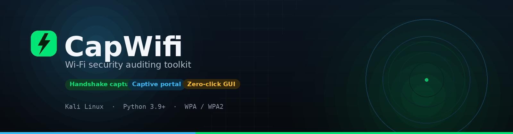
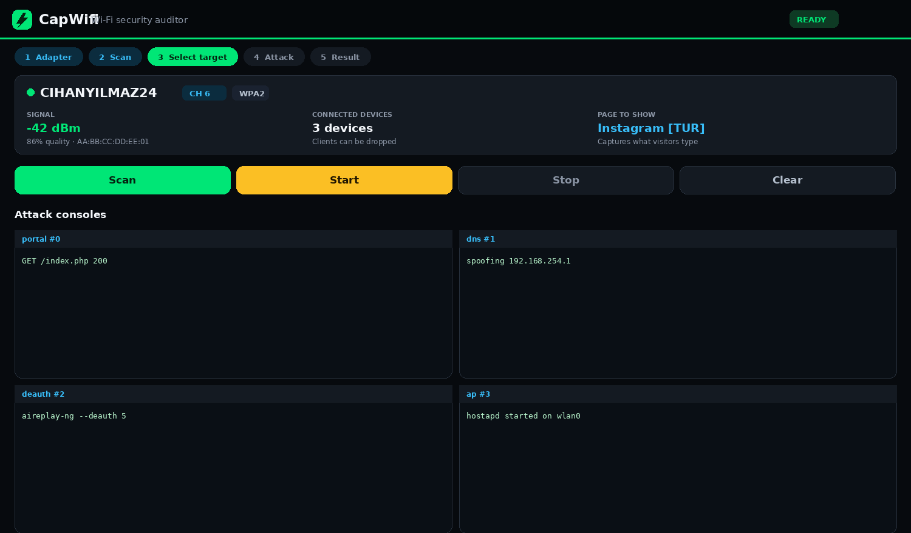

<div align="center">



**Audit WPA/WPA2 networks you own — from a guided desktop app or a scriptable CLI.**

[](https://www.kali.org/)
[](https://www.python.org/)
[](LICENSE)
[](#development)

[Quick start](#quick-start) · [Desktop app](#desktop-application) · [CLI](#command-line) · [Troubleshooting](#troubleshooting) · [Project layout](#project-layout)

</div>

---

## What it is

CapWifi audits Wi-Fi networks by capturing WPA/WPA2 handshakes and by running a
captive portal (evil twin) against access points you are authorised to test.

Two front-ends sit on the same engine. Pick whichever fits the job:

| | **Desktop app** | **CLI** |
|---|---|---|
| **Start with** | `./run_gui.sh` | `sudo ./capwifi.sh` |
| **Best for** | everyday use, no flags to memorise | scripts, CI, headless boxes |
| **Needs a display** | yes | no (`-m` for tmux) |
| **Guidance** | step bar, live consoles, hints | prompts and `--auto` |



<sub>The desktop app: selected-network summary, four embedded attack consoles, and a
live log — no terminal windows to hunt down.</sub>

---

## Attacks

| Attack | What it does | What you get |
| --- | --- | --- |
| **Handshake Snooper** | Drops clients from the target AP so they reconnect, then captures the WPA/WPA2 four-way handshake | A `.cap` file to crack offline |
| **Captive Portal** | Clones the target AP and serves a login page from one of 68 bundled templates, recording what visitors submit | Credentials in the workspace log |

Either attack runs on one adapter. Two adapters — one for the rogue AP, one for
deauthentication — is the more reliable setup.

<details>
<summary><b>Bundled portal templates</b></summary>

Seven Instagram variants and seven generic Wi-Fi password variants (English, Turkish,
German, Spanish, French, Italian, Brazilian Portuguese) plus consumer router brands
such as ARRIS, TP-Link, HUAWEI and Netgear.

Templates that ship their own `submit.php` record submissions directly, so they do not
need a captured handshake to verify a password. The Instagram and Wi-Fi password
families are both self-capturing and appear first in the portal picker.

</details>

---

## Quick start

```bash
git clone https://github.com/sametuca/capwifi.git
cd capwifi

./run_gui.sh          # desktop app — installs what it needs, escalates once
# or
sudo ./capwifi.sh     # interactive terminal UI
```

Nothing has to be installed by hand. Both front-ends check for every dependency on
start and install what is missing through `apt`:

```bash
sudo ./capwifi.sh --install-deps   # just the dependency pass, then exit
```

---

## Requirements

- **Linux**, ideally Kali rolling. Any Debian-derived distribution with the same
  packages works.
- **Root.** Monitor mode, `hostapd`, `iptables` and the DHCP server all need it. The
  GUI refuses to open without it and tells you how to relaunch.
- **A wireless adapter with monitor mode and frame injection.** Most built-in laptop
  cards cannot do this. Atheros AR9271, Ralink RT3070/RT5370 and Realtek RTL8812AU are
  known to work. Inside a VM, pass the USB adapter through — bridging the host card is
  not enough.
- **Python 3.9+** for the desktop app. The launcher installs `python3-tk` if missing.

<details>
<summary><b>Runtime packages</b></summary>

`aircrack-ng`, `airmon-ng`, `hostapd`, `lighttpd`, `php-cgi`, `kea-dhcp4`, `dnsspoof`,
`mdk4`, `iw`, `iptables`, `macchanger`, `rfkill`, `nmap`, `openssl`, `7zr`, `unzip`,
and either `xterm` or `tmux` (with `-m`).

</details>

---

## Desktop application

```bash
./run_gui.sh
```

The launcher does the environment work for you:

1. Checks `python3` and installs `python3-tk` / `python3-venv` if missing.
2. Creates a virtual environment with `customtkinter` and `pillow`.
3. Asks for `sudo` once, then re-executes itself as root.
4. Opens the window.

### The workflow

The step bar tracks where you are — **Adapter → Scan → Select target → Attack →
Result** — and the bar at the bottom always states the single next action.

1. **Adapter** — pick a card, or leave everything on automatic if you have one.
2. **Scan** — choose a duration and band, then **Scan**. Longer scans see more
   *clients*, not just more networks.
3. **Select target** — click a network card. The summary card fills in with signal,
   connected devices and the page that will be shown; fields fill themselves.
4. **Attack** — press **Start**. Adapter, channel and deauth method are chosen for you.
5. **Result** — credentials land on the Passwords tab with a copy button. A captured
   handshake appears in the archive with "Use with portal" and "Crack with aircrack".

Consoles are embedded: every window the attack opens (portal, DNS, deauth, AP) appears
as its own scaled pane, and the app switches to the Consoles tab on its own the moment
they appear. The app **updates itself from the banner at the top** — the window locks,
a progress bar runs, and a final screen asks you to restart.

<details>
<summary><b>Reading the UI</b></summary>

- Signal strength is drawn as four bars coloured by quality; the dBm value is kept for
  precision.
- A green client pill means a device is associated — the only networks where
  deauthentication can produce a result.
- A check mark means a handshake for that network is already saved.
- `DFS` marks radar channels (52–64, 100–144). The rogue AP cannot start there with
  `hostapd`; the engine falls back to `airbase-ng` in auto mode.
- Language switches with the **EN / TR** control in the top bar. The window re-renders
  in place, a running attack keeps going, and the choice is remembered. Force it for
  one run with `CAPCAP_GUI_LANG=en|tr`.

</details>

---

## Command line

```bash
sudo ./capwifi.sh             # interactive, prompt-driven
sudo ./capwifi.sh --help      # full manual page
```

<details open>
<summary><b>Common flags</b></summary>

| Flag | Purpose |
| --- | --- |
| `--auto` | Fully non-interactive; every prompt takes a default, one attack cycle, then exit |
| `-m` | Use `tmux` instead of `xterm`; enables headless operation without X11 |
| `-k` | Kill interfering wireless processes first |
| `-l <lang>` | UI language code (`en`, `tur`, …) |
| `-a <attack>` | `"Captive Portal"` or `"Handshake Snooper"` |
| `-b <bssid>` / `-e <essid>` | Target by MAC or by network name |
| `-c <channel>` | Restrict the scan / lock the channel |
| `--band bg\|a\|abg` | 2.4 GHz, 5 GHz, or both |
| `--scan-time <s>` | Scanner duration in seconds (default 30) |
| `--scan-only` | Print nearby networks as a table and exit |
| `--list-interfaces` | Print adapters with bands, driver, chipset and state |
| `--install-deps` | Install whatever is missing, then exit |
| `--interface` / `--jammer-interface` / `--ap-interface` | Assign a card to a role |
| `--ap-channel <ch>` | Run the rogue AP on a different channel |
| `--ap-service hostapd\|airbase-ng` | Rogue AP backend |
| `--deauth-method aireplay-ng\|mdk4` | Deauthentication method (default `aireplay-ng`) |
| `--site <template>` | Portal template, e.g. `Instagram_tur`, `WiFi_tur` or `ARRIS_en` |
| `--timeout <min>` | Stop the attack after N minutes |
| `--reg-domain <CC>` | Regulatory domain for 5 GHz |
| `--kill-exclude <name,…>` | Processes to spare when killing interference |

</details>

<details>
<summary><b>Examples</b></summary>

```bash
# See what the adapter can do
sudo ./capwifi.sh --list-interfaces

# Survey nearby networks for a minute
sudo ./capwifi.sh --scan-only --scan-time 60 --band abg

# Headless handshake capture against a specific AP, 20 minute limit
sudo ./capwifi.sh -m --auto -a "Handshake Snooper" \
     -b AA:BB:CC:DD:EE:FF -c 6 --timeout 20

# Captive portal with the Turkish Instagram template, two adapters
sudo ./capwifi.sh -m --auto -a "Captive Portal" -l tur \
     -b AA:BB:CC:DD:EE:FF --ap-interface wlan1 --jammer-interface wlan0
```

</details>

> [!NOTE]
> Deauthentication is not a question: `aireplay-ng` is used unless
> `--deauth-method mdk4` overrides it. `mdk4` only transmits after it observes client
> traffic, so on a quiet network it looks like nothing is happening. In auto mode the
> channel tracker is off unless `--tracker-interface` is given.

---

## How an attack runs

```
scan ─→ select target ─→ prepare (monitor mode, services, firewall)
     ─→ run attack ─→ collect result ─→ restore system state
```

`capwifi.sh` orchestrates the attacks under `attacks/`. Each attack owns its
preparation, its windows and its teardown. Progress is written to a status file so any
front-end — the GUI, a script, a CI job — can follow along without parsing terminal art.

```text
[2026-10-31T12:04:11] SCAN_START interface=wlan0 duration=30s
[2026-10-31T12:04:44] SCAN_COMPLETE candidates=14
[2026-10-31T12:04:52] TARGET_SELECTED ssid=Example bssid=AA:BB:CC:DD:EE:FF channel=6
[2026-10-31T12:05:01] ATTACK_STARTED attack=Captive Portal
[2026-10-31T12:07:39] RESULT password=… ssid=Example bssid=AA:BB:CC:DD:EE:FF
```

Everything is restored on exit: interfaces leave monitor mode, `iptables` is restored
from the backup taken at startup, and system services are restarted.

---

## Output and workspace

The workspace defaults to `/tmp/capcapspace`, created with `0700` permissions. Override
it with `CAPCAPWorkspacePath`.

| Path | Contents |
| --- | --- |
| `capcap.status` | Timestamped event log (auto mode only) |
| `instagram_credentials.log` | Tab-separated portal submissions — time, client IP, username, password, user agent; rotates at 512 KiB keeping `.1`–`.3`. The historical filename is shared by the Instagram and Wi-Fi portals. |
| `attacks/Handshake Snooper/handshakes/` | Captured `.cap` files |

---

## Troubleshooting

<details>
<summary><b>No wireless interfaces / <code>--list-interfaces</code> is empty</b></summary>

The adapter is not visible to Linux. Check `iw dev`. In a VM, attach the USB adapter to
the guest instead of bridging the host card.

</details>

<details>
<summary><b>Monitor mode or injection tests fail</b></summary>

Not every card supports them. Run `airmon-ng check kill` (or pass `-k`) first, then
retry. On macOS hosts the driver is almost always the culprit, not CapWifi.

</details>

<details>
<summary><b>Portal is up but nothing is captured</b></summary>

The target AP needs at least one connected client, otherwise there is no traffic to
deauthenticate. Re-scan with a longer duration and pick a network with a green client
pill. If no networks are in range, the app now says so instead of showing a stale list.

</details>

<details>
<summary><b>The app will not start</b></summary>

It needs root. Launch it with `./run_gui.sh`; it escalates once and reuses that session.
Running `python3 gui/app.py` directly will not have the privileges the attacks need, so
the app shows a warning and exits.

</details>

<details>
<summary><b>Attack starts on a DFS channel</b></summary>

`hostapd` needs radar detection support there. Pass `--ap-channel` to serve the rogue AP
on a non-DFS channel — normally this needs a second adapter.

</details>

---

## Project layout

```text
capwifi/
├── capwifi.sh               # entry point, orchestration and CLI
├── run_gui.sh               # desktop launcher (installs, escalates)
├── gui/
│   ├── app.py               # window layout, workflow, guidance
│   ├── controller.py        # runs the engine, parses status, tails the workspace
│   ├── theme.py             # colour tokens and contrast helpers
│   ├── effects.py           # buttons, spinners, notification bar
│   ├── widgets.py           # network cards, signal bars, log, checklist
│   ├── root_gate.py         # refuses to start without root
│   └── models.py            # plain data classes
├── attacks/
│   ├── Captive Portal/      # evil twin attack and 68 portal templates
│   └── Handshake Snooper/   # handshake capture
├── lib/                     # shared shell libraries, installer, window manager
├── language/                # CLI locale strings (en, tur, …)
├── scripts/                 # portal build/verify helpers
└── tests/                   # shell and GUI test suites
```

---

## Development

```bash
bash tests/run_safe_suite.sh        # everything that needs no hardware
bash scripts/run_shellcheck.sh      # shell lint against the accepted baseline
python3 tests/test_gui_imports.py   # GUI imports and syntax
```

The safe suite covers locale loading, CLI parsing, hash handling, target selection,
channel selection, sandbox utilities, the Instagram and Wi-Fi portal servers, the
`--install-deps` surface, and the desktop app: theme contrast, single-view behaviour,
the scan flow, real pointer clicks, the console grid, the root gate and the update modal.

Tests that need `aircrack-ng` or real adapters live outside the suite and are expected
to fail on non-Linux hosts.

Portal templates are generated from `scripts/instagram_portal/` and
`scripts/wifi_portal/`. Edit the source, run `python3 scripts/build_instagram_portals.py`
and `python3 scripts/build_wifi_portals.py`, and `--check` in CI catches drift.

---

## Intended use

> [!WARNING]
> CapWifi is an auditing tool. Use it **only** on networks you own or have explicit
> written permission to test. Running it against third-party networks is illegal in
> most jurisdictions and outside the scope of what this project supports.

Maintained by [sametuca](https://github.com/sametuca) · GPL-3.0 ·
[report a bug](https://github.com/sametuca/capwifi/issues)
